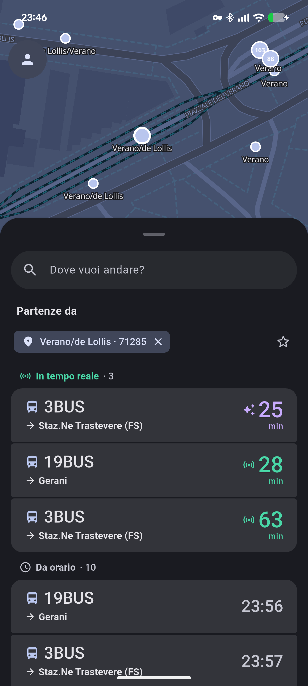
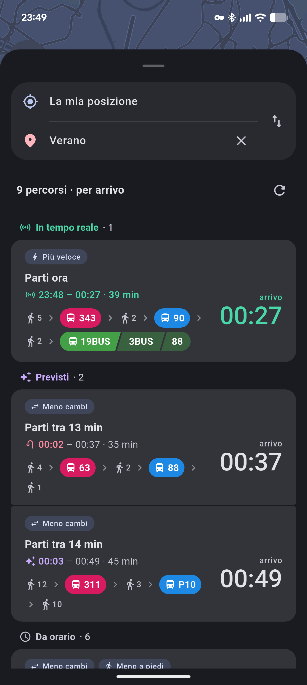
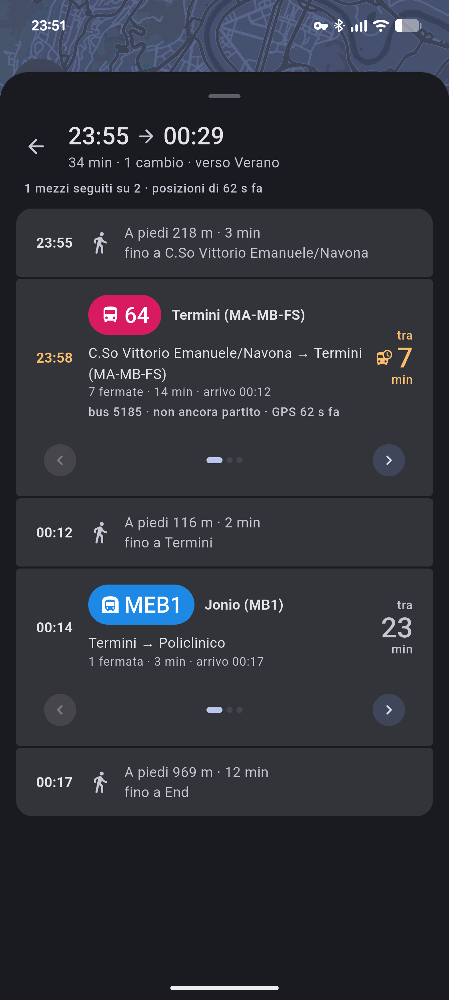
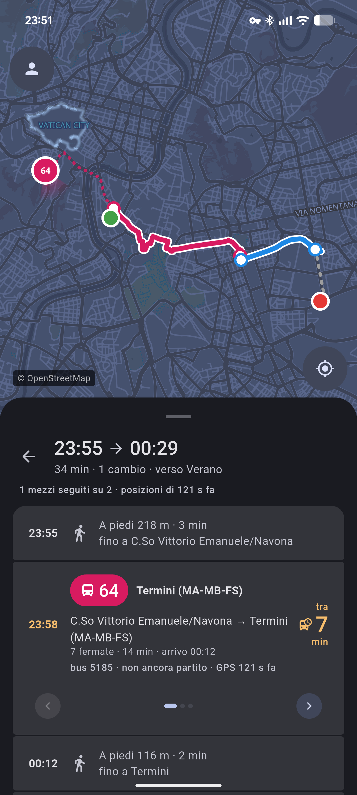
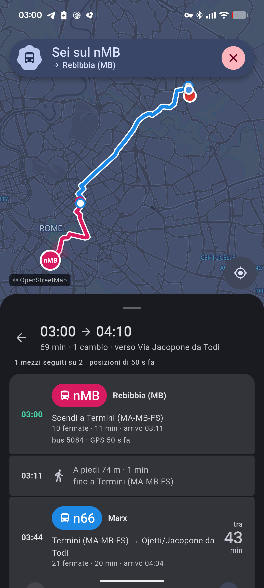

# Trames

**Trames** is a public transport app. It shows the stops and buses around you on a map, tells you what's leaving next, and plans journeys using live data wherever it's available.

## Features

- **Live map**: nearby stops and buses moving in real time, with their direction of travel.
- **Departures near you**: the next departures from the closest stops, or from any stop you pick.
- **Journey planning**: routes from where you are (or anywhere) to your destination. Each one is marked as live, predicted or scheduled, so you know how far to trust the times.
- **Lines**: open a line to see its route and the buses running on it.
- **On board**: Trames notices when you're riding a bus and plans the rest of your journey from there.
- **Favourites**: keep your usual stops and places one tap away.
- **Your preferences**: tell it how much you like walking and how fast you walk. Your walking speed can also be calibrated automatically from your GPS.
- Light and dark theme, in English and Italian.

The app is built with Flutter. However, since I have no iPhone, I am only distributing it for Android and web (https://trames.realac.ci). But you can build it for iOS yourself.

Trames is built on two services:

- **[MOTIS](https://github.com/motis-project/motis)**, an open-source journey planner, handles routes and timetables. By default Trames uses [Transitous](https://transitous.org), a free, community-run MOTIS server covering transit around the world, but you can point it to your own.
- **[Tramite](https://git.marcorealacci.me/marcorealacci/tramite)**, made specifically for Trames. It processes the operators' GTFS feeds and tries to predict departures that have no forecast, and streams the data in real-time using SSE.

Tramite is optional and the app can work with MOTIS alone, but you will lose live GPS positions and time predictions. I built Tramite because in my city (Rome), the data provided by the operator is often incomplete: many rides have no forecast until the bus actually leaves the terminus, and buses can drop out of the feed before they finish their trip. Tramite fills these gaps, so the app can still give you a realistic idea of when your bus will show up.

Maps from OpenStreetMap.

### Why Trames?

[trāmĕs], tramitis

Sostantivo maschile III declinazione

1 scorciatoia, via traversa, strada secondaria 
2 sentiero, cammino, passaggio 
3 (in senso figurato) strada, percorso, corso 